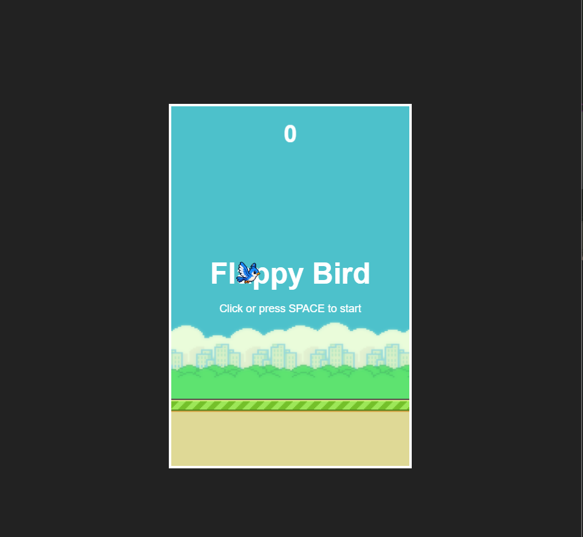
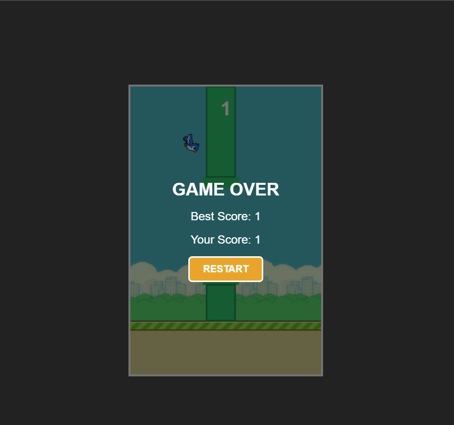
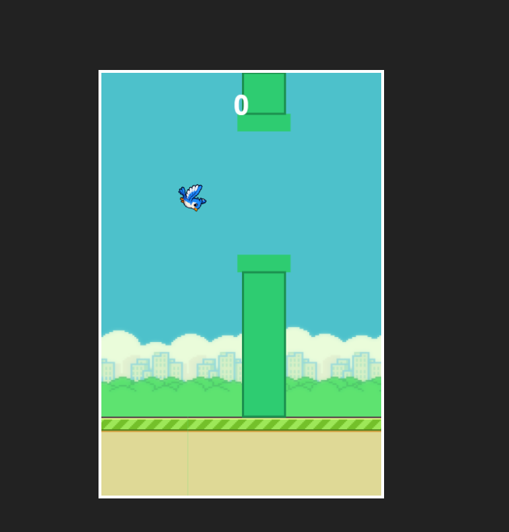

# Flappy Bird
A simple Flappy Bird-inspired browser game built using HTML, CSS, and vanila JS

This Project is designed as an eductional project for beginners who want to undestand the fundamentals of 2D game devlopment and Github commit better. withour using heavy frameWorks or game engines.

## Features

- Classic Flappy Bird-Style gameplay
- Bird movement with gravity and flap phyics
- Randomly generated pipes
- Collision detection
- Score tracking
- Presistent best score using `localStorage`
- Background and ground scrolling
- Sound effects and background music
- Game-over screen and restart functionality
- Delta-time-bassed movement for consistent game speed

### Demo

**[Play Flappy Bird Online](https://flappygird.netlify.app/)**

## Screenshot

### Screenshot 1



### Screenshot 2


### Screenshot 3


## Controls

| Action | Control |
|---|---|
| Start game | Click or press `Space` |
| Make the bird fly | Click or press `Space` |
| Restart | Click the Restart button or press `Space` after game over |

## Technologies Used

- **HTML5** - Game structure and Canvas element
- **CSS3** - Layout and game intterface
- **HTML Canvas API** - Drawing the Game world
- **Web Audio API / HTML Audio** - Music and sound effects
- **localStorage** - Saving the best score

No game engine or Javascript framework is required.

## Project Structure

```text
flappy-bird/
│
├── index.html
│
├── css/
│   └── style.css
│
├── js/
│   ├── main.js
│   │
│   ├── entities/
│   │   ├── bird.js
│   │   └── pipe.js
│   │
│   └── systems/
│       ├── audio.js
│       └── collision.js
│
└── assets/
    ├── background-day.png
    ├── base.png
    ├── bird-1.gif
    │
    └── music/
        ├── bgm.mp3
        ├── hit.mp3
        ├── wings.mp3
        └── point.mp3
```

## Getting Started

### 1. Clone the repository

```bash
git clone https://github.com/cyberworrier8088/FlappyBird.git
```

### 2. Enter the project directory

```bash
cd FlappyBird
```

### 3. Start a local development server

JavaScript ES module should be served through a local HTTP server server rather than opened directly using `file://`.

If Python is installed:

```bash
python -m http.server 8000
```

### 4. Open the game

Visit:

```text
http://localhost:8000
or 
https://flappygird.netlify.app
```

## Eductional Goals

This project is also a practical introduction to important game-development concepts.

## Who Is This Project For?

This project is suitable for:

- Beginners learning JavaScript and Github.
- Students exploring game development.
- Developers learning HTML canvas.
- Anyone intersted in undestanding game loops, phyics, and collision detection.

## Contributing

Contributions, suggestion, and eductional improvements are welcome!

1. Fork the repository.
2. Create a new branch.
3. Make your changes.
4. Test your changes.
5. Submit a Pull Request.

## License

MIT License


---

**Built as a learning project. The goal is not just to play a game, but to understand how one works. and Github commit**